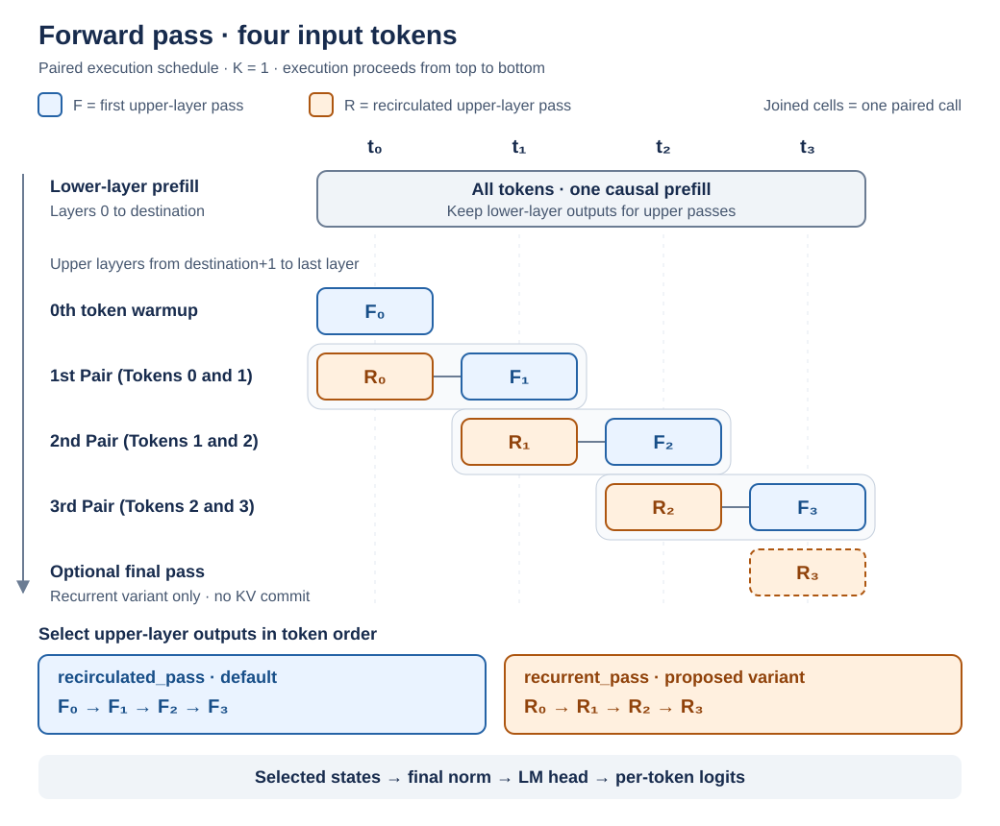
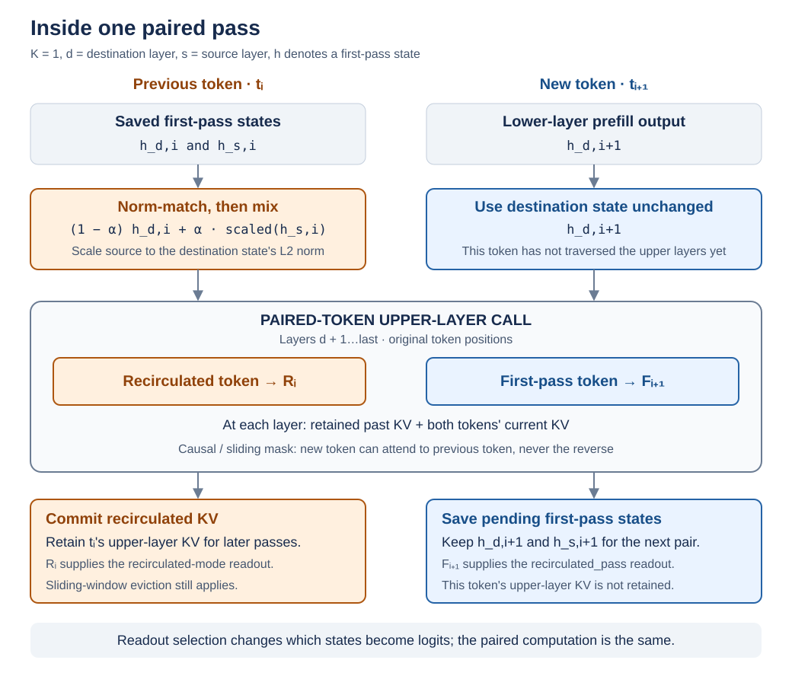

# Recirculation

This project implements DeepMind's **Recirculation** method for Transformer language models and investigates its behavior in a reproducible experimental setting. The goal is to reproduce key results from the original paper, evaluate the method through controlled ablations, and explore extensions and modifications to the original approach.

## Forward pass

[`RecirculatedGemma.recirculated_run`](recirculation/recirculated_gemma.py) processes a complete input sequence with a fresh cache by default and returns logits at every token position. The last position's logits predict the next token. The diagrams below describe the **K = 1 paired execution schedule**.

Layer indices are zero-based: **lower layers** are from `0` to `destination`, and **upper layers** are from `destination + 1` to the last layer. Recirculation reuses the lower-layer outputs and reruns only the upper layers.

### Execution schedule and output selection



1. **Lower-layer prefill:** process all input tokens together through the lower layers with causal attention. Keep their destination-layer hidden states for the upper passes.
2. **First-token warmup:** process token 0 through the upper layers once. Save its first-pass source and destination hidden states for recirculation.
3. **Paired passes:** recirculate token `i` alongside the first upper-layer pass of token `i + 1`, in one two-token call. Save the new token's first-pass source and destination states for the following pair.
4. **Optional final recirculation (recurrent variant):** rerun the final token's upper layers to read out its recirculated state. The paper-faithful readout does not need this pass.

`F` and `R` in the diagram are final upper-layer hidden states, before the model's final normalization and language-model head:

- **`recirculated_pass` (default, paper-faithful readout, implemented by `recirculated_run` and `recirculated_generate`):** select the initial warmup output and each pair's new-token first-pass output. No separate final-token pass is needed.
- **`recurrent_pass` (experimental variant):** select each pair's recirculated-token output and the separate final-token recirculation output.

The selected states are concatenated in token order, then passed through final normalization and the LM head. For a single-token input, the paired loop is empty: `recirculated_pass` reads out the warmup state, while the proposed `recurrent_pass` would read out the optional recirculation. A first-pass output can already incorporate **earlier tokens' recirculated context**.

### Inside a paired pass



Let $h_{d,i}$ and $h_{s,i}$ be token $i$'s saved first-pass hidden states **after** the destination and source layers. Its recirculated input to layer `destination + 1` is:

$$
\widetilde{h}_i = \beta h_{d,i} + \alpha\frac{\lVert h_{d,i}\rVert_2}{\lVert h_{s,i}\rVert_2}h_{s,i}.
$$

The norm is computed over the hidden dimension for each token. The paired upper-layer input is $[\widetilde{h}_i,\ h_{d,i+1}]$: the previous token is mixed, while the new token uses its unchanged lower-layer output. Each token keeps its original position ID.

At each upper layer, attention uses retained past KV together with both tokens' newly computed KV, subject to the layer's causal/sliding-window mask. The new token can attend to the recirculated previous token; the previous token cannot attend to the new token. Only the recirculated token's KV is committed. The new token's first-pass source and destination hidden states are saved separately for the next pair.

### Cache behavior

[`RecirculationDynamicCache`](recirculation/recirculated_cache.py) separates **KV available to the current attention calculation** from **KV retained for later passes**. `commit_tokens` controls retention:

| Stage | `commit_tokens` | Newly committed KV |
| --- | --- | --- |
| Lower-layer prefill | `None` | All input tokens, in lower layers |
| Initial upper-layer warmup | `0` | None |
| Paired upper-layer pass | `1` | Previous token's recirculated KV only |
| Optional final upper-layer recirculation (`recurrent_pass` variant) | `0` | None; readout only |

Full-attention layers retain all committed KV. Sliding-window layers retain at most `sliding_window - 1` committed positions in the normal execution path; current attention still receives the KV needed before that eviction.

After a sequence of length `N`, the lower layers have committed `N` positions and the upper layers `N - 1`, subject to sliding-window eviction. **The final token's upper-layer KV remains uncommitted.** Each `recirculated_run` call rebuilds the cache by default. For K = 1 autoregressive decoding, `recirculated_generate` reuses the cache across generated tokens within one request, selects next tokens from `recirculated_pass` logits, and resets the state between requests.

## Environment setup

Requirements:

- Python 3.12 (uv downloads the pinned version if needed)
- [uv](https://docs.astral.sh/uv/getting-started/installation/)

To install the dependencies, run one of the following commands from the repository root:

```bash
uv sync --extra cpu     # CPU-only machine
uv sync --extra cuda    # NVIDIA GPU with a CUDA 13.0-compatible driver
```

**Note:** Always pass `--extra cpu` or `--extra cuda` to `uv sync` and `uv run`.
Otherwise, Accelerate's dependency on PyTorch can select a different build.

For VSCode notebooks, select `.venv/bin/python` as the kernel.

## Running tests

From the repository root:

```bash
uv run --extra cpu python -m pytest tests -q
```

Use `--extra cuda` instead if that is your installed backend.

Gemma integration checks cover CPU FP32, CUDA FP32, and CUDA BF16; unsupported
hardware configurations are explicitly skipped. See
[numerical validation](docs/numerical-validation.md) for coverage, tolerances and commands to reproduce the checks.
